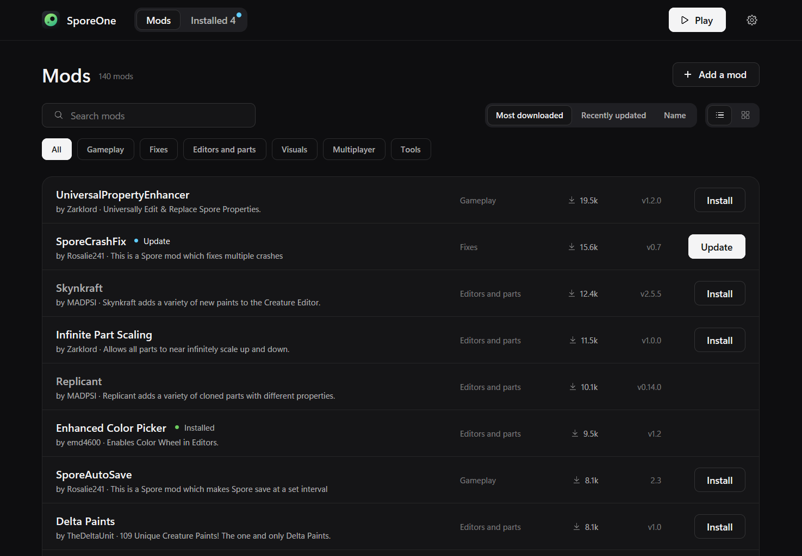

# SporeOne


A mod manager for Spore on Windows. It installs mods into the Spore ModAPI Launcher Kit the same
way its Easy Installer does, so both programs see the same mods.



SporeOne shows the community's mods as a list or a grid. Before it installs one, it checks that
the mod fits your game and Launcher Kit, and it installs what the mod depends on first, in order.
It keeps mods up to date and updates itself from its own releases. You can also add a mod that is
not in the catalog, from a GitHub link or by dropping its file on the window, and suggest one for
the catalog with a button.

Version 0.0.4. SporeOne is not made by EA or Maxis, and the mods it lists are their authors' work.

## Install

Download the setup or the zip from the [latest release](https://github.com/Brunovncs/SporeOne/releases/latest).
The setup installs for your user and needs no administrator rights. The program is not signed yet,
so Windows SmartScreen warns the first time you run it.

## Requirements

Windows 10 or 11, and Spore with Galactic Adventures from Steam, GOG, the EA app or the disc. You
also need the Launcher Kit, which SporeOne can install for you. A Steam copy has to be started once
from Steam before mods can go in.

## The catalog

A workflow in this repository builds the catalog every six hours. It takes every GitHub repository
with the `spore-mod` topic, which is what the [Spore Mod Browser](https://mods.sporecommunity.com)
reads, plus the suggestions a maintainer approved. Then it applies `catalog/curated.json`, kept by
hand for mods on other sites, mods with their own installer and compatibility notes. Each file is
downloaded once to record its SHA-256, and SporeOne refuses a download that does not match.

## Getting a mod listed

Publish it on GitHub with the `spore-mod` topic, a `ModInfo.xml` at the root of the repository and
the `.sporemod` or `.package` on a release. It shows up on the next build. For a mod someone else
made, or one published elsewhere, open a
[Suggest a mod](https://github.com/Brunovncs/SporeOne/issues/new?template=suggest-mod.yml) issue.
Fixes to the curated list are welcome as pull requests.

## Multiplayer

[SporeCoop](https://github.com/WoodyWizard/SporeCoop) adds co-op for two to four players. It is
experimental and has its own installer, which SporeOne downloads and runs. It works with the Steam
and GOG copies only.

## Safety

Every install is worked out as a plan first, and each path in it is checked to be inside the game's
data folders or the Launcher Kit. No plan touches the game's own files. When the game folder needs
administrator rights, SporeOne asks for them only to carry out a plan it has already checked.

## Building

SporeOne is written in Rust with [GPUI](https://www.gpui.rs).

```
cargo build --release
cargo test --workspace
cargo run -- --demo
```

`--demo` runs against a fake game and Launcher Kit in a temporary folder, so you can try it without
Spore. `cargo run -p sporeone-catalog` builds the catalog and wants a token in `GITHUB_TOKEN` or
`GH_TOKEN`.

## License

MIT. Spore is a trademark of Electronic Arts.
